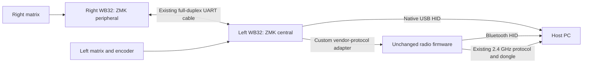

# GMK70 ZMK feasibility

Investigated 2026-10-26, against repository revision
`91131f728b3c97a1ff1f80305719c7fa534fba68`. This is a source-based feasibility
assessment. No ZMK port, board scaffold, West workspace, dependency change,
firmware build or device operation was performed.

## Finding

A port on the existing GMK70 PCB is plausible. It requires a **new WB32FQ95
Zephyr SoC integration**, GMK70 board definitions, and hardware drivers. The
recommended first target is **USB typing**, followed by both halves over their
existing UART cable. Retaining Bluetooth and the 2.4 GHz dongle is a later,
separate vendor-radio integration; the radio can initially keep its stock
firmware.

The Cortex-M3 CPU architecture is already supported by Zephyr. I did not locate
a usable public WB32 Zephyr/ZMK port in the inspected upstream trees, vendor
repositories or bounded searches. This finding does not rule out an unindexed
fork. The substantial work is the WB32 peripherals and board integration.

## Versions and evidence

These are frozen **research references**, not newly installed dependencies:

| Component | Inspected revision |
| --- | --- |
| ZMK | [`4dd95d7840eb3d5a3f59bb29fbf1ab054715ef85`](https://github.com/zmkfirmware/zmk/tree/4dd95d7840eb3d5a3f59bb29fbf1ab054715ef85) |
| Zephyr selected by that ZMK manifest | `zmkfirmware/zephyr`, `v4.1.0+zmk-fixes`, resolved to [`10ba6d0cb38bc3d258775d27982f707599320085`](https://github.com/zmkfirmware/zephyr/tree/10ba6d0cb38bc3d258775d27982f707599320085) |
| Current upstream Zephyr, additional support search | [`bc5d59d1b6657cfeef30124b818c8fbd69da68ac`](https://github.com/zephyrproject-rtos/zephyr/tree/bc5d59d1b6657cfeef30124b818c8fbd69da68ac) |
| Existing local QMK reference | `0.34.4`, `08c662f286ddfd12a985f57b584b02eca5af0ae6` |
| Its vendor-authored ChibiOS-Contrib WB32 reference | [`5a9ad82b6ba4f649cdb800e8c2bbc9be2d3ce767`](https://github.com/qmk/ChibiOS-Contrib/tree/5a9ad82b6ba4f649cdb800e8c2bbc9be2d3ce767/os/hal/ports/WB32/WB32FQ95xx) |

The [ZMK manifest](https://github.com/zmkfirmware/zmk/blob/4dd95d7840eb3d5a3f59bb29fbf1ab054715ef85/app/west.yml)
selects its own Zephyr fork. Neither that fork's inspected SoC inventory nor
current upstream's has a WB32/Westberry family. The selected fork's USB driver
inventory also has no WB32 driver. Searches of the
[vendor organization](https://github.com/WestberryTech) and WB32/Zephyr/ZMK
references found QMK/ChibiOS and independent Rust work, without an established
Zephyr port.

## Existing hardware and what can be reused

These assignments come from the maintained
[board definition](../firmware/qmk-common/keyboards/zuoya/gmk70/keyboard.json),
[configuration](../firmware/qmk-common/keyboards/zuoya/gmk70/config.h),
[clock configuration](../firmware/qmk-common/keyboards/zuoya/gmk70/mcuconf.h)
and wireless drivers. They are firmware evidence, without a new electrical
measurement.

| Part | GMK70 evidence | ZMK/Zephyr route |
| --- | --- | --- |
| Main controllers | WB32FQ95 Cortex-M3, one per half; current clock 96 MHz | Reuse ARM architecture support; add WB32 SoC, clock, pin control and peripheral drivers. |
| Matrix | 5 rows per half; 8 physical left columns and 9 right columns; ROW2COL; current debounce 5 ms | GPIO matrix scanning and position transforms already exist. Requires working WB32 GPIO. |
| Encoder | Left only, B7/B6 | Existing EC11 integration after GPIO support; verify direction and detents. |
| Inter-half link | UART1, A9 TX/A10 RX, full duplex, 115200 baud | Current ZMK wired split is a good physical match once WB32 UART works. Both halves need the ZMK protocol. |
| Host radio | UART3, C10 TX/C11 RX, 115200 baud, external Freqchip module | Add an adapter for the existing vendor HID/control/status protocol. |
| RGB | WS2812 via SPIM2/B15; 36 left and 41 right; RGB byte order | Zephyr LED-strip abstraction is suitable after SPI support. Stock effects and indicator overlays need separate behavior work. |
| Settings | External SPI NOR on B3/B4/B5, C12 chip select | Zephyr SPI-NOR/settings may be usable after WB32 controller integration and flash/partition verification. |
| Power | LED rails A5/A8, USB power B1, cable detect A7, charge-full A15 | Explicit GPIO/power/USB integration; sleep and wake need a WB32 PM design. |

Full matrix pins: rows A1/A2/A3/A4/C13; left columns
C0/C1/C2/C3/A6/B10/B11/B12; right columns
B13/B14/C6/C7/C8/C9/C4/C5/B0. The extra logical left column is unwired.
Handedness is B9. B6 also participates in existing wake handling; pin ownership
must account for its encoder use.

ZMK's current [wired split documentation](https://zmk.dev/docs/features/split-keyboards)
supports one central and one peripheral over full-duplex UART, with an
early-adopter maturity warning. The inspected source also has experimental
half-duplex options; GMK70 does not require those. Matching baud rates will not
make QMK transactions compatible with ZMK commands/events.

ZMK normally assigns central/peripheral roles at build time. The central owns
keymap state and host reports. A standard peripheral does not present as a USB
keyboard. The current QMK ability to promote a directly USB-connected right
half for recovery therefore needs an explicit replacement. Preserve independent
recovery for both halves before any transition.

## The main new work: WB32 support

For a minimal awake USB keyboard, the required work is:

1. SoC metadata, devicetree, startup/linking and memory layout, using Zephyr's
   Cortex-M3 exception/context support and potentially its existing SysTick
   driver.
2. Correct oscillator, PLL, cache, bus clocks, peripheral resets and USB 48 MHz
   clock setup.
3. WB32 GPIO and pin configuration. Interrupt/EXTI support follows for wake and
   interrupt-driven peripherals; initial scanning can be polled.
4. A USB device-controller driver compatible with the **selected ZMK/Zephyr USB
   API**, including endpoint control, reset, suspend/resume and report delivery.
5. Board scan-to-position layout and ZMK keymap/behaviors.

UART, settings flash, LEDs, radio and low-power operation then build on that
foundation. A DMA implementation is not a prerequisite for initial typing.

The vendor-authored ChibiOS code already documents working register sequences,
interrupts, FIFO handling and clocks. Its driver callbacks, scheduling and
locking need adaptation to Zephyr. WB32 has concrete register/layout differences
from STM32, including its protected clock/analog setup, GPIO write-mask register
and USB controller; selecting an STM32 board is not supported by this evidence.

Useful independent references are
[keeberry](https://github.com/dot-agi/keeberry/tree/ccae6dbea51c5ec830aef0b31db12905e09e871a),
an author's Rust/Embassy keyboard firmware, and its
[mini-MUSB WB32 profile](https://github.com/dot-agi/musb/blob/28961a7035678dcec842666cb5a12906550b650a/registers/profiles/wb32fq95.yaml).
They provide additional USB/register knowledge rather than a Zephyr driver.
That USB profile has EP0 plus EP1–3; the eventual composite HID/CDC configuration
needs an endpoint-budget check.

The inspected vendor WB32 headers and peripheral sources carry Apache-2.0
notices. The independent keeberry/PAC code is GPL-2.0-or-later, while the inspected
MUSB fork declares Apache-2.0. Preserve exact file licenses and provenance when
adapting anything. Hardware assignments and protocol evidence can inform new
implementations without importing QMK's entire implementation.

QMK-derived integration must retain compatible copyleft terms. Upstream ZMK
also has its own [clean-room contribution policy](https://zmk.dev/docs/development/contributing/clean-room),
which restricts referencing GPL implementations. This investigation supports a
local port in this repository; it does not establish eligibility to submit that
implementation upstream as MIT code.

## Bluetooth and 2.4 GHz with the original radio

The practical candidate architecture is:

This route can defer radio firmware changes. Existing
[module framing](../firmware/qmk-common/drivers/wireless/module.c) and
[report conversion](../firmware/qmk-common/drivers/wireless/wireless.c) provide
the protocol evidence: keyboard, consumer, system and mouse reports; channel
selection/pairing; acknowledgements; connection, battery and host-LED events.
The new application must preserve the asynchronous command/state rules and
release input correctly during switches/disconnections.

There is a ZMK integration cost beyond a UART driver. At the reviewed revision,
[endpoint types](https://github.com/zmkfirmware/zmk/blob/4dd95d7840eb3d5a3f59bb29fbf1ab054715ef85/app/include/zmk/endpoints_types.h)
and [routing](https://github.com/zmkfirmware/zmk/blob/4dd95d7840eb3d5a3f59bb29fbf1ab054715ef85/app/src/endpoints.c)
explicitly handle NONE, USB and native BLE, without a general endpoint registry.
A first-class vendor transport likely needs a small maintained ZMK patch for
endpoint identity, dispatch, readiness and selection. The parser, radio driver
and board behaviors can stay in this repository's local module. A completely
patch-free module replacement has not been demonstrated.

Native `&bt` controls Zephyr Bluetooth connections and bonds. Stock BT1–5 and
dongle selection need custom behaviors tied to the radio's own state. Its bonds
remain in the radio. Enabling `CONFIG_ZMK_BLE` alone starts the native Bluetooth
host and does not supply this adapter.

Report translation also matters: the stock radio carries one consumer usage,
8-bit mouse axes and its own six-key-plus-overflow keyboard representation.
ZMK can produce multiple consumer usages, 16-bit mouse axes and a different
NKRO representation. Define an initial supported subset and test full parity
separately; do not copy report structures verbatim or silently truncate deltas.
Stock system power/sleep/wake reports need explicit coverage too.

Native ZMK BLE through an external HCI controller is another possible
architecture, but the captured stock UART is a vendor application protocol.
No compatible controller-only/HCI mode or firmware and transport has been
established for this module. Replacing its firmware could also affect the
proprietary dongle link. It is unnecessary for the initial USB port and is not
the recommended first route.

## Memory, storage and updater constraints

Main-MCU memory must be distinguished from radio memory and external settings
flash. Vendor-authored linker variants describe:

| WB32FQ95 variant | Main flash | SRAM |
| --- | ---: | ---: |
| x9 | 96 KiB | 28 KiB |
| xB | 128 KiB | 28 KiB |
| xC | 256 KiB | 36 KiB |

The [vendor reference manual](https://www.westberrytech.com/uploads/file/WB32FQ95xx/EN_RM2905025_WB32FQ95xx_V01.pdf)
describes family maxima of 256 KiB flash and 36 KiB SRAM. Generic WB32FQ95 naming
does not identify the installed variant. The project's
[saved updater evidence](SPLIT-UPDATER.md) records **256 KiB/36 KiB for the user's
two previously inspected halves**; other GMK70 revisions still require their
own evidence. Current QMK/updater linking conservatively uses 28 KiB SRAM.

Keeping the installed resident updater adds specific constraints from
[image.h](../firmware/qmk-common/keyboards/zuoya/gmk70/update/image.h) and
[image.c](../firmware/qmk-common/keyboards/zuoya/gmk70/update/image.c):

- Resident occupies the first 8 KiB. Application starts at `0x08002000` and has
  a **120 KiB maximum**; staging and commit metadata occupy other reserved ranges.
- The validator requires an aligned initial stack no higher than `0x20007000`.
  Existing boot magic uses `0x20006FFC`. A normal full-36-KiB Zephyr startup is
  not automatically compatible, even if its program fits in flash.
- Application-side USB commands, split relay, flash access and boot-entry
  semantics would need a Zephyr implementation. Successful boot through the
  resident would not establish that subsequent split updates work.

WB32 ROM DFU remains a separate recovery mechanism. Generic UF2 or MCUboot
settings do not implement it. Before selecting an installation layout, verify
per-half recovery and preserve bootloader/resident regions. Existing updater
relay and actual interrupted-update recovery still have hardware-validation
limits documented in the updater guide.

Settings are another migration: ZMK uses Zephyr settings, not VIA/Vial EEPROM.
The current settings flash can erase a whole **64 KiB block**, despite its
smaller logical EEPROM allocation; diagnostics start at external `0x10000`.
Any new settings partition must respect actual capacity/erase geometry and
retained data. Zbit ID `5E3213` identifies the previously observed external
512 KiB NOR, not the main MCU or radio's program memory. Saved Vial maps/macros
need explicit conversion; raw EEPROM reuse is not a compatible import.

No ZMK application size, RAM fit, power consumption or latency is established.
Avoiding the native BLE host with the stock-radio architecture saves that
particular cost, but USB, split queues, keymap features, RGB and Studio still
need actual ELF/map and runtime stack measurements.

For early development while retaining the installed updater, the
[staging-slot trial investigation](ZMK-UPDATER-TRIAL.md) proposes keeping Vial in
the application slot, running ZMK from the other slot, and using a watchdog reset
to return to Vial. This could support iterations through the same left USB
connection before ZMK itself implements the updater. It needs a new trial
extension and hardware proof; the current resident alone does not provide it.

## Studio and feature parity

[ZMK Studio](https://zmk.dev/docs/features/studio) is the appropriate native
configuration UI for a ZMK port. VIA/Vial keycode definitions and EEPROM do not
configure ZMK directly.

USB Studio is a plausible later variant: it uses the main MCU's CDC-ACM
interface, physical layout metadata, persistent settings and `&studio_unlock`.
Enable it on the central only, after USB HID and settings work. At this source
revision, the RPC thread's default stack alone is 4096 bytes; actual memory
budgeting is necessary on WB32.

BLE Studio uses a dedicated encrypted GATT service and Zephyr connection state.
The stock radio's existing 32-byte raw tunnel does not establish that transport.
Neither previous Web Vial radio experiments nor ordinary BLE typing prove
unchanged Studio will work wirelessly. USB Studio can proceed independently.

Studio supports runtime assignment of compiled behaviors, with fewer runtime
editing options than this Vial build. For example, the current UI does not
provide equivalent macro/combo creation or encoder assignment. Those settings
can instead be defined in the ZMK source configuration. GMK70-specific controls
would become custom ZMK behaviors with their own human-readable metadata.

ZMK's [LED-strip support](https://zmk.dev/docs/features/lighting) can drive
per-key WS2812 hardware once the controller driver exists. Exact QMK reactive
effects, decorative engine, radio/battery indicators and split synchronization
remain separate compatibility requirements. Sleep also needs explicit WB32
STOP/clock/EXTI/UART restoration and both-half wake testing. Native ZMK idle
settings cannot substitute for that integration.

## Recommended order after an implementation decision

| Stage | Deliverable and proof required |
| --- | --- |
| 1. Establish boundaries | Record installed main-MCU variants, flash geometry, per-half recovery, preserved settings and resident-compatible memory layout. Freeze ZMK/Zephyr revisions. |
| 2. Bring up WB32 | Minimal Zephyr startup/timer/clocks/GPIO, then USB enumeration and HID with controlled LED/radio state. Verify recovery independently from typing. |
| 3. Basic keyboard | Left USB matrix, layout, held modifiers/chords, debounce and encoder; independently validate the right hardware. Measure the minimal image and RAM. |
| 4. Complete wired split | Matching ZMK on both halves over UART1; position ordering, simultaneous input, link loss/reconnect and deliberate right-side USB/recovery behavior. |
| 5. Restore board features | Separate settings partition, RGB and indicators, power/charging, first-key and peer wake. Then add the vendor-radio endpoint for BLE and 2.4 GHz, with profile/report parity tests. |
| 6. Optional variants | USB Studio, then resident/split update support, each with independent memory and recovery validation. Wireless Studio/HCI is a separate investigation. |

All maintained integration would live under `firmware/zmk/` in this repository:
local module/SoC/drivers/board definitions, behaviors, variant configuration,
dependency records and any reviewed ZMK patch series. Upstream sources and
generated files belong in an ignored workspace; QMK/Vial dependencies stay
unchanged. This follows the existing [platform architecture](FIRMWARE-ARCHITECTURE.md).

A conversion to a supported controller such as an nRF52 is an alternative with
much better existing ZMK software support. It requires PCB/controller changes
and does not automatically retain the stock radio/dongle link. For the existing
PCB, the USB-first WB32 port is the best-supported starting point from this
investigation.
